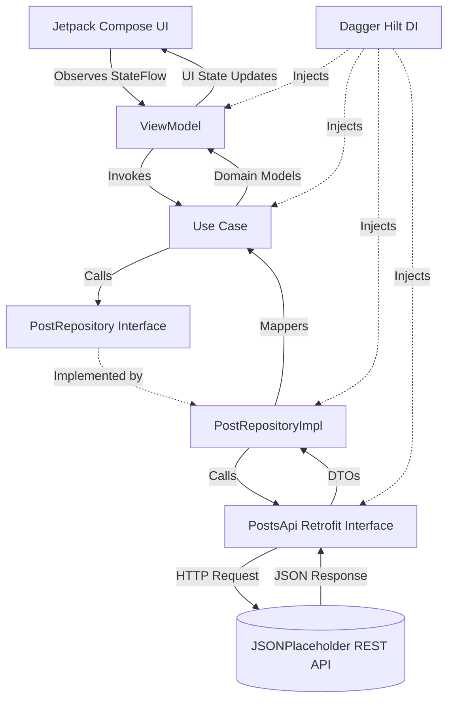

# JSONPlaceholder Android Client

A modern Android application built with Kotlin and Jetpack Compose that consumes the [JSONPlaceholder](https://jsonplaceholder.typicode.com/) REST API. This project demonstrates clean architecture principles, modern reactive UI development, and robust dependency injection using industry-standard Android libraries.

---

## 🚀 Overview & Learning Objectives

This application is designed as a reference implementation for production-ready Android development practices. Its primary objectives include:
- Implementing **Clean Architecture** with strict separation of concerns across Data, Domain, and Presentation layers.
- Building reactive, declarative UIs using **Jetpack Compose** and **Material 3**.
- Managing asynchronous operations and state propagation with **Kotlin Coroutines** and **StateFlow**.
- Centralizing dependency management and lifecycle handling with **Dagger Hilt**.
- Consuming REST APIs cleanly and safely using **Retrofit** and **Gson**.

---

## 🛠️ Technology Stack

| Technology | Library / Version | Purpose |
| :--- | :--- | :--- |
| **Language** | Kotlin `2.1.0` | Core programming language |
| **UI Toolkit** | Jetpack Compose (`2024.12.01` BOM) | Declarative UI framework |
| **Design System** | Material 3 | Modern Android styling & components |
| **Architecture** | MVVM + Clean Architecture | Separation of presentation, business logic, and data |
| **Dependency Injection** | Dagger Hilt `2.51.1` | Compile-time dependency injection |
| **Networking** | Retrofit `2.11.0` + Gson (`2.11.0`) | REST API client and JSON deserialization |
| **Concurrency** | Kotlin Coroutines & Flow `2.8.7` | Asynchronous programming & reactive state flows |
| **Navigation** | Navigation Compose `2.8.5` | Type-safe screen routing and argument passing |
| **Lifecycle** | Lifecycle ViewModel KTX `2.8.7` & SavedStateHandle | UI state retention and parameter extraction |
| **Build & Tooling** | AGP `8.7.3`, KSP `2.1.0-1.0.29`, Java 11 | Compilation and symbol processing |

---

## 🏛️ Architecture

The project follows a multi-layered **Clean Architecture** structure:

```
[Presentation Layer] (Compose UI, ViewModels, UI States)
         ↓ depends on
[Domain Layer] (Models, Repository Interfaces, Use Cases)
         ↑ implemented by
[Data Layer] (DTOs, Retrofit API, Mappers, Repository Implementations)
```

### Layer Responsibilities
1. **Presentation (`com.example.jsonplaceholder.presentation`)**: Contains Jetpack Compose UI screens (`PostsScreen`, `PostDetailsScreen`, `CommentsScreen`), ViewModels (`PostsViewModel`, `PostDetailsViewModel`, `CommentsViewModel`), and UI state definitions (`PostsUiState`, `PostDetailsUiState`, `CommentsUiState`).
2. **Domain (`com.example.jsonplaceholder.domain`)**: Contains pure Kotlin business models (`Post`, `Comment`), repository interfaces (`PostRepository`), and business use cases (`GetPostsUseCase`, `GetPostUseCase`, `GetCommentsUseCase`). This layer has zero dependencies on Android or framework libraries.
3. **Data (`com.example.jsonplaceholder.data`)**: Implements data sources and repositories. Contains Retrofit DTOs (`PostDto`, `CommentDto`), the REST API interface (`PostsApi`), extension mappers (`toDomain()`), and repository implementations (`PostRepositoryImpl`).
4. **Dependency Injection (`com.example.jsonplaceholder.di`)**: Houses Hilt modules (`NetwokModule`, `RepositoryModule`) responsible for providing singletons and interface bindings.

### Architecture Data Flow



---

## 📱 Application Features & API Endpoints

The application provides a seamless three-tier navigation and data flow:

1. **Posts List**: Fetches and displays a list of posts from the API. Clicking any post navigates to its details.
   - **Endpoint**: `GET /posts`
2. **Post Details**: Displays the title and body of a selected post, along with an action button to view its comments.
   - **Endpoint**: `GET /posts/{id}`
3. **Comments List**: Displays user comments associated with the selected post.
   - **Endpoint**: `GET /comments?postId={id}`
4. **State Management**: Every screen robustly handles `Loading`, `Success`, and `Error` states, providing retry capabilities when network or server errors occur.

---

## 🗂️ Project Structure

```text
app/src/main/java/com/example/jsonplaceholder/
├── JsonPlaceholderApplication.kt       # Hilt application entry point (@HiltAndroidApp)
├── MainActivity.kt                     # Host activity with @AndroidEntryPoint & NavHost
├── data/
│   ├── mapper/
│   │   ├── CommentMapper.kt            # Maps CommentDto to domain Comment
│   │   └── PostMapper.kt               # Maps PostDto to domain Post
│   ├── remote/
│   │   ├── CommentDto.kt               # Network data transfer object for comments
│   │   ├── PostDto.kt                  # Network data transfer object for posts
│   │   └── PostsApi.kt                 # Retrofit service interface defining endpoints
│   └── repository/
│       └── PostRepositoryImpl.kt       # Concrete implementation of PostRepository
├── di/
│   ├── NetwokModule.kt                 # Hilt module providing Retrofit and PostsApi
│   └── RepositoryModule.kt             # Hilt module binding PostRepositoryImpl
├── domain/
│   ├── model/
│   │   ├── Comment.kt                  # Domain model for comment
│   │   └── Post.kt                     # Domain model for post
│   ├── repository/
│   │   └── PostRepository.kt           # Abstract repository interface
│   └── usecase/
│       ├── GetCommentsUseCase.kt       # Encapsulates fetching comments for a post
│       ├── GetPostUseCase.kt           # Encapsulates fetching a single post by ID
│       └── GetPostsUseCase.kt          # Encapsulates fetching all posts
└── presentation/
    ├── comments/
    │   ├── CommentsScreen.kt           # Composable screen for displaying comments
    │   ├── CommentsUiState.kt          # UI state sealed interface for comments
    │   └── CommentsViewModel.kt        # ViewModel managing comments screen state
    ├── details/
    │   ├── PostDetailsScreen.kt        # Composable screen for post details & navigation
    │   └── PostDetailsViewModel.kt     # ViewModel using SavedStateHandle to load post details
    ├── navigation/
    │   └── AppNavigation.kt            # Navigation graph managing routes and arguments
    └── posts/
        ├── PostsScreen.kt              # Composable screen listing all posts
        └── PostsViewModel.kt           # ViewModel managing posts list state
```

---

## ⚙️ Setup and Execution

### Prerequisites
- **Android Studio** (Koala or newer recommended)
- **JDK 11** (configured as project source/target compatibility)
- **Android SDK** with `compileSdk = 35` and `minSdk = 24`
- An Android Emulator or physical device running Android 7.0 (API 24) or higher with internet access.

### Getting Started
1. Clone the repository:
   ```bash
   git clone <repository-url>
   ```
2. Open the project folder in **Android Studio**.
3. Allow Gradle to synchronize dependencies automatically (or click **Sync Project with Gradle Files**).
4. Run the app on your connected emulator or device via Android Studio or using Gradle:
   ```bash
   ./gradlew :app:installDebug
   ```

### Running Tests
To run unit tests:
```bash
./gradlew :app:testDebugUnitTest
```

---

## 💉 Dependency Injection with Hilt

Dagger Hilt manages object instantiation and lifecycle bindings across the application:
- **Application Scope**: `@HiltAndroidApp` annotates [JsonPlaceholderApplication.kt](file:///C:/Users/Adrian-PC/AndroidStudioProjects/jsonPlaceholder/app/src/main/java/com/example/jsonplaceholder/JsonPlaceholderApplication.kt), initializing Hilt's dependency graph.
- **Activity Scope**: `@AndroidEntryPoint` annotates [MainActivity.kt](file:///C:/Users/Adrian-PC/AndroidStudioProjects/jsonPlaceholder/app/src/main/java/com/example/jsonplaceholder/MainActivity.kt).
- **ViewModel Injection**: `@HiltViewModel` combined with `@Inject constructor(...)` enables automatic ViewModel provisioning with Jetpack Navigation and `SavedStateHandle`.
- **Modules**:
  - [NetwokModule.kt](file:///C:/Users/Adrian-PC/AndroidStudioProjects/jsonPlaceholder/app/src/main/java/com/example/jsonplaceholder/di/NetwokModule.kt): Provides singleton instances of `Retrofit` configured with the base URL `https://jsonplaceholder.typicode.com/` and Gson converter, as well as the `PostsApi` service.
  - [RepositoryModule.kt](file:///C:/Users/Adrian-PC/AndroidStudioProjects/jsonPlaceholder/app/src/main/java/com/example/jsonplaceholder/di/RepositoryModule.kt): Uses `@Binds` to bind `PostRepositoryImpl` to the `PostRepository` interface.

---

## 🔮 Current Limitations and Future Improvements

### Implemented Features
- Full Clean Architecture separation (Data, Domain, Presentation).
- Reactive state management with Kotlin `StateFlow`.
- Dependency injection via Dagger Hilt.
- Type-safe navigation with argument passing (`SavedStateHandle`).
- Comprehensive UI state handling (Loading, Success, Error with retry).

### Potential Future Improvements
- **Local Persistence**: Implement Room database for offline-first caching of posts and comments.
- **Pagination**: Add paging support (Paging 3) for efficient handling of large remote datasets.
- **Testing Suite**: Implement comprehensive JUnit unit tests for ViewModels and Use Cases, along with Compose UI instrumented tests (`ui-test-junit4`).
- **Enhanced Error Handling**: Differentiate between network timeouts, HTTP status errors, and parsing exceptions with domain-specific error models.
